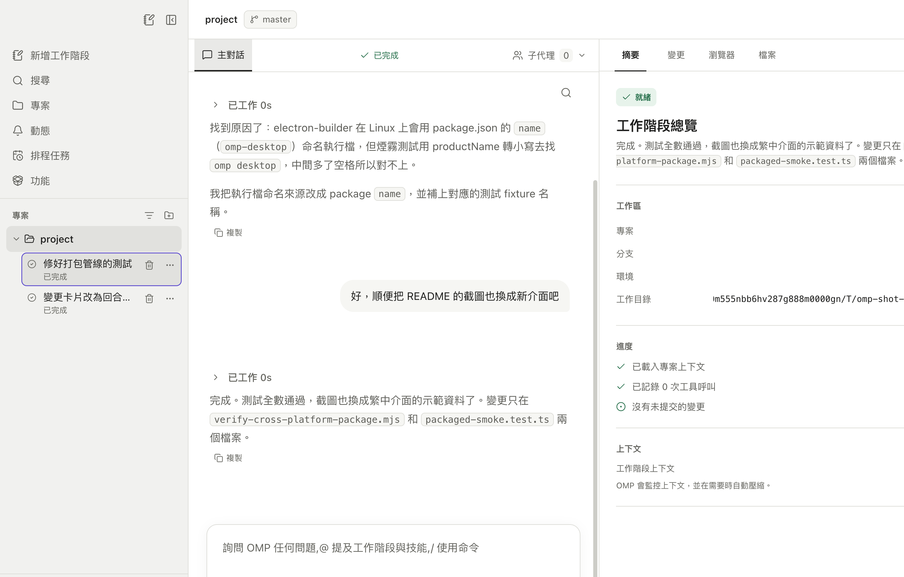

# OMP Desktop

OMP Desktop is a desktop workspace for [OMP](https://github.com/can1357/oh-my-pi) ([omp.sh](https://omp.sh)). It gives the coding agent a friendly native interface on macOS, Linux, and Windows while leaving the harness in charge of its own models, logins, and saved sessions.



## Attribution

OMP Desktop is a derivative of [GooeyPi](https://github.com/am-will/gooey-pi) by [am-will](https://github.com/am-will) and its contributors, forked at GooeyPi 1.1.17 and reworked into an OMP-only desktop workspace. The upstream project is licensed under the MIT License, and its notice is preserved in [LICENSE](LICENSE) alongside this fork's. OMP itself is [oh-my-pi](https://github.com/can1357/oh-my-pi) by can1357.

## What you can do

### Work with agents

- Stream conversations with Markdown, reasoning summaries, tool activity, retries, and context compaction. Thinking sections can start expanded for every session (**Settings → Harness**), and each one still folds on demand.
- Search loaded conversation history with ⌘F / Ctrl+F, including reasoning and tool arguments. Search temporarily reveals matching collapsed content; closing it restores the disclosures. Saved sessions load up to the latest 400 messages, with separate content budgets.
- Retry a failed turn through OMP's native `/retry`, restore its prompt beside an existing draft, or copy the error.
- Pin the subagent roster, filter by activity, and see unread updates without losing each agent's reading position.
- Revisit the latest five command results in the current workspace, including after closing the output panel.
- Choose a model, reasoning level, and Fast mode when the selected model supports it.
- Queue a follow-up or steer an agent while it is working.
- Paste or drop PNG, JPEG, GIF, and WebP images into a prompt when the model supports vision.
- Resume, rename, search, and archive persistent sessions.
- See running, finished, failed, and waiting-for-input work in one Activity view, then clear items you have handled.

### Keep projects organized

- Add local folders and reopen sessions grouped by project.
- Search projects, chats, and branches from the sidebar.
- Switch between linked Git worktrees from the composer.
- Create a branch worktree and open it as a new OMP Desktop workspace.
- Mention another top-level session with `@session`, copy its UUID, or let agents create and message model-selected sessions for parallel work.

### Use the built-in coding workspace

- Review Git status and diffs, stage or unstage files, restore changes with confirmation, and commit without leaving the app. After each reply, the changes card lists only the files that turn edited — never older dirty state — with a one-click undo for that batch.
- Browse project files and reveal them in your system file manager.
- Open multiple terminal tabs for a session. Highlight terminal output to attach it to the next prompt.
- Open the right-hand Summary, Changes, Browser, or Files panel whenever you need it.

### Browse with shared context

- Use an isolated in-app browser with an address bar, navigation history, downloads, and an external-browser handoff.
- Point at page elements and add notes. OMP Desktop attaches those annotations to your next message.
- Enable browser control so an agent can open and operate its own tabs. You can watch its cursor and work in the same tabs when you want to take over.

### Automate repeat work

- Create one-time or recurring schedules.
- Pick the project or existing session, model, reasoning level, timezone, and Fast mode.
- Run a schedule immediately, pause or resume it, and inspect the result and run history.
- On macOS, opt in under **Settings → General** to keep scheduled work running from the menu bar after closing the window, and optionally launch OMP Desktop in the background at login. The packaged app also accepts `--background` to start without opening its window.

### Add capabilities

The Capabilities page brings together packages, plugins, extensions, skills, prompts, and MCP servers. OMP Desktop can manage local stdio MCP definitions for OMP. Network MCP and authentication stay under the harness's direct control; those entries are visible but read-only in OMP Desktop, with bounded definition-only removal available for cleanup. MCP discovery has an independent 2,500-definition-per-settings-file limit and reports an explicit warning when that limit is exceeded, so unrelated capabilities cannot hide supported MCP rows.

OMP Desktop also ships optional capabilities for:

- Let an agent ask you a small set of questions in a native dialog.
- Give agents controlled access to the in-app browser.
- Use TryCUA computer control when the separate CUA Driver is installed.

Ask User and computer control are off by default. You can enable, disable, or remove capabilities from the app.

### Talk instead of type

- Dictate prompts with OpenAI, Groq, Deepgram, or a local `whisper.cpp` installation.

### Make it comfortable

- Choose a light, dark, or system theme and adjust the interface text size.
- Use the app in English, 繁體中文, or 简体中文 — pick a language or follow the system (**Settings → Appearance**).
- Reduce motion, resize the workspace panels, or let them become overlays in a narrow window.
- Use keyboard navigation and the command palette for common actions.

## Get started

1. Install [OMP](https://github.com/can1357/oh-my-pi).
2. Sign in or configure a model provider through the omp CLI.
3. Download OMP Desktop from [GitHub Releases](https://github.com/SenCha930511/omp-desktop/releases), or run it from source.
4. Add a project folder and start a session.

OMP Desktop checks common install locations automatically. If the harness is missing, open **Settings → Harness** to refresh detection or choose its executable.

GitHub Releases provides a DMG and ZIP for macOS (Apple Silicon and Intel), common Linux package formats plus AppImage, and a Windows installer and ZIP. Each release page also lists `SHA256SUMS.txt` covering every asset.

Release builds are not code-signed or notarized, so the first launch needs one extra step:

- **macOS**: right-click the app in `/Applications` and choose **Open** (or clear it once in **System Settings → Privacy & Security**) to pass Gatekeeper.
- **Windows**: SmartScreen shows "Windows protected your PC" — choose **More info → Run anyway**.
- **Linux**: package installs work as usual; no signature prompts.

Harness provider credentials stay with the harness. Optional voice keys are encrypted with the operating system's secure storage, and local `whisper.cpp` dictation needs no API key.

Upgrading from GooeyPi? OMP Desktop migrates your projects, schedules, settings, voice keys, and agent-message signing key from the old application data directory on first run.

## Run from source

You will need Node.js 24.15.0 or newer and npm 12.0.2 or newer. The repository pins Node.js 24.15.0 in `.nvmrc`; with [nvm](https://github.com/nvm-sh/nvm), you can select it with:

```bash
nvm install && nvm use
npm run toolchain:bootstrap
```

The bootstrap command verifies the exact size and SHA-512 of the checked-in npm archive, then installs it offline with install-time lifecycle scripts disabled into the invoked npm's configured global prefix, verifies the installed CLI and both tool versions against `package.json` and `.nvmrc`, and makes its shim available to subsequent GitHub Actions steps before dependencies are installed.

```bash
npm install
npm run dev
```

If `node_modules/electron/dist` is missing after installation, fetch Electron's platform binary before starting the app:

```bash
node node_modules/electron/install.js
npm run dev
```

`npm install --ignore-scripts` skips both Electron's platform download and the native dependency rebuild, so it is not enough on its own for running OMP Desktop from source. If you used it, the recovery sequence below runs those two steps explicitly.

`node-pty` is a native dependency. If Electron cannot rebuild it with your default Python environment, point npm at a Python installation with the required build tools:

```bash
export npm_config_python=/path/to/python3
npm install --ignore-scripts
node node_modules/electron/install.js
npx electron-builder install-app-deps
```

## Keyboard shortcuts

Use `⌘` on macOS and `Ctrl` on Linux or Windows.

| Shortcut | Action |
|---|---|
| `⌘/Ctrl+N` | New session |
| `⌘/Ctrl+K` | Command palette |
| `⌘/Ctrl+B` | Toggle the project sidebar |
| `⌘/Ctrl+Shift+B` | Open the browser |
| `⌘/Ctrl+J` | Toggle the terminal |
| `⌘/Ctrl+,` | Open Settings |
| `Enter` | Queue a message while the agent is working |
| `⌘/Ctrl+Enter` | Steer the current turn while the agent is working |
| `Shift+Enter` | Add a new line |
| `Esc` | Close the active menu, dialog, or overlay |

The Queue and Steer shortcuts can be swapped in **Settings → Harness → Message shortcuts**.

## Local data and safety

OMP Desktop is built around local projects and local harness sessions. It does not rewrite session history or take ownership of OMP credentials.

Remote pages open in a separate browser profile with Node access disabled. Project paths and desktop actions are checked in the main process, and third-party capabilities still run with your operating-system permissions. Review packages, commands, MCP servers, and projects before allowing them to act.

For suspected vulnerabilities, follow the [security policy](.github/SECURITY.md) and do not post sensitive details publicly. See [docs/security.md](docs/security.md) for the full technical security model.

## Development checks

Run these before submitting a code change:

```bash
npm run typecheck
npm run check
npm test
npm run test:e2e
npm run build
```

See the [validation guide](docs/validation.md) for the source-of-truth checks and reproducible commands.

To make an installable local QA build, run the command for your operating system:

```bash
npm run package:mac:local-qa
npm run package:linux:local-qa
npm run package:win:local-qa
```

Build packages on their target operating system so native dependencies match the release.

## License

OMP Desktop is released under the permissive [MIT License](LICENSE). See the [license text](LICENSE) for details.
